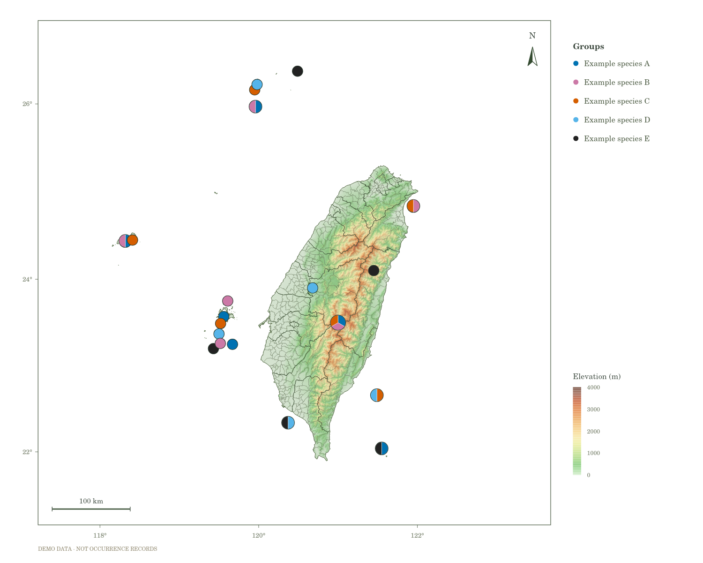

# TaiwanBioTopoMaps｜臺灣生物地形地圖

**匯入採集紀錄，在瀏覽器中製作臺灣與離島的物種分布圖及地形圖。**

## [🌏 開啟互動網站｜Open the web app](https://ychsiao-tw.github.io/TaiwanBioTopoMaps/)

[English](#english) · [示範資料](examples/example_5species_all_regions.csv) · [回報問題](https://github.com/YCHsiao-TW/TaiwanBioTopoMaps/issues)

**版本：3.0.0｜作者：Yu-Chun Hsiao｜程式授權：MIT**

TaiwanBioTopoMaps 整合資料匯入、物種篩選、地形與版面調整，以及圖檔輸出。不需要安裝 R、註冊帳號或設定 API 金鑰，開啟網站即可使用。



*上圖使用合成示範資料，點位與分群不代表真實物種分布。*

## 快速開始

1. 開啟[互動網站](https://ychsiao-tw.github.io/TaiwanBioTopoMaps/)，在「資料」匯入 CSV 或 TSV。
2. 確認經度、緯度與物種欄位，檢查有效及排除的紀錄。
3. 勾選物種、調整顏色，到「樣式」設定地圖範圍、地形、點位、圖例與版面。
4. 等待地形載入完成，到「輸出」下載地圖，或批次輸出各物種地圖。
5. 需要日後繼續編輯時，下載完整 `.tbm.json` 專案，之後重新匯入即可接續製圖。

第一次使用可下載[五物種範例 CSV](examples/example_5species_all_regions.csv)，或匯入[完整示範專案](examples/example_project.tbm.json)。兩者均使用 **28 筆合成紀錄、20 個不同座標、5 個分群**。

透過 **EN／中文** 切換介面語言；原始資料欄位與物種名稱保留原文。

## 主要功能

| 類別 | 功能 |
| --- | --- |
| 資料匯入 | CSV／TSV、UTF-8／Big5、自動辨識與手動指定欄位；下載有效資料及排除原因 |
| 地圖範圍 | 臺灣本島、臺灣與離島、臺灣＋金門；金門、馬祖、澎湖、綠島、蘭嶼、龜山島、小琉球；自訂範圍、平移與縮放 |
| 地形底圖 | 彩色海拔、地形陰影、光源與陰影強度；快速、自動、精細、最高品質 DEM |
| 物種點位 | 個別配色、物種名稱斜體、點位大小、座標整併、多物種共域圓餅圖、可選樣點編號 |
| 地圖元素 | 縣市及鄉鎮界線、中英文行政區名稱、經緯度外框與網格、指北針、比例尺 |
| 圖面配置 | 9 種版面預設、自訂寬高與方向交換；圖例位置、1–3 欄、字級與符號尺寸 |
| 地圖輸出 | PNG、SVG、PDF，以及整體與各物種地圖的批次 ZIP |
| 資料與專案 | 有效資料 CSV、樣點對照表 CSV、設定 JSON、完整 `.tbm.json` 專案 |

取消勾選物種時，地圖點位與圖例同步更新。批次輸出共用已勾選物種的配色、圖例與地圖範圍，方便比較不同物種。

## 資料格式

第一列為欄位名稱，座標使用 **WGS84 十進位經緯度**：

```csv
longitude,latitude,species,locality
121.0000,23.5000,Example species A,Demo site 1
121.0000,23.5000,Example species B,Demo site 1
120.6800,23.9000,Example species A,Demo site 2
```

| 欄位 | 說明 |
| --- | --- |
| `longitude` | 經度，例如 `121.0000` |
| `latitude` | 緯度，例如 `23.5000` |
| `species` | 物種或其他分群名稱；可省略 |
| `locality` | 選用的採集地點說明 |

欄位名稱可以不同，匯入後可手動指定。經度與緯度必須來自不同欄位；額外欄位及重複紀錄會保留。紀錄筆數模式會計入重複列，請先確認資料是否需要去除重複。

## 點位整併與圓餅圖

- **座標整併**：依指定小數位數捨入後分組，採五成雙捨入（ties-to-even）。這是座標格網整併，不是依固定距離聚合；非常接近但落在不同格的點位仍可能分開。
- **出現／未出現模式**：同一樣點中，各個有出現的物種占相同比例。
- **紀錄筆數模式**：依各物種的資料列數分配圓餅比例。只有每列代表一個體時，才可將其解讀為個體數比例。
- **樣點編號**：依全部有效資料的來源順序建立，篩選及批次輸出共用編號；改變座標整併設定會重新建立編號。
- **樣點對照表**：包含 `site_id`、`longitude`、`latitude`、`taxon`、`record_count`、`site_total_records`、`source_rows`。涵蓋已勾選物種的樣點，包括目前畫面外的點位；`source_rows` 為解析後的紀錄列號。

## 輸出與保存

| 格式 | 內容與用途 |
| --- | --- |
| PNG | 完整點陣圖，可設定輸出解析度，適合簡報及一般圖像使用 |
| SVG | 界線、點位及文字為向量；地形與陰影為嵌入式點陣，可供後續排版編輯 |
| PDF | 嵌入完整點陣圖，適合分享或列印；文字與點位無法獨立編輯 |
| ZIP | 批次整理整體及各物種地圖，並附相關資料表 |
| 設定 JSON | 保存製圖設定，不取代包含資料的完整專案 |
| `.tbm.json` | 保存全部解析後紀錄（含排除資料）、配色、篩選、視角、版面、語言與輸出設定 |

**重新整理或關閉頁面前，請先下載完整專案。** 專案檔不包含另外從網路載入的 DEM 圖磚，再次開啟時可能需要重新下載地形。

CSV 與專案資料在瀏覽器內處理，應用程式不將匯入紀錄上傳至資料處理伺服器。網站資源及額外地形圖磚仍需透過網路讀取。完整專案檔包含匯入紀錄，分享時請留意其中的採集點資訊。

## DEM 與地圖資料

地形提供快速、自動、精細與最高品質四種模式，最高可請求 **z12** 圖磚。實際等級依縮放、範圍及圖磚數量上限調整；範圍過大時會降低等級。畫面下方顯示實際 DEM 等級與載入進度，載入完成後才能輸出含地形的圖檔。

專案已內建臺灣範圍的 **25 張 z8 圖磚**；其他範圍或更高等級需要網路。較高圖磚等級可增加顯示細節，但不代表上游海拔資料的實際測量精度同步提高。

- **地形來源**：Mapzen／AWS Terrain Tiles，Terrarium 格式；應用程式計算海拔配色與地形陰影。
- **行政界線**：Taiwan Atlas **2021.9.20** 歷史快照，含 22 縣市及 368 鄉鎮市區，不代表最新行政或地籍界線。
- **地圖投影**：Web Mercator（EPSG:3857），比例尺依畫面中心緯度計算。

完整資料來源、署名與授權見 [THIRD_PARTY_NOTICES.md](THIRD_PARTY_NOTICES.md)。

## 本機執行

下載並解壓縮專案，安裝 Python 3 後，在專案資料夾執行：

```bash
python3 serve.py
```

Windows 可使用 `py -3 serve.py`。macOS 也可雙擊 `START_MAC.command`；若無法直接執行，請使用上述終端機指令。

程式會開啟本機網站，伺服器僅綁定 `127.0.0.1`。使用期間保留終端機，按 `Ctrl+C` 停止。請透過本機 HTTP 網址開啟，而非直接雙擊 `dist/index.html`。額外 DEM 圖磚仍需網路。

## 開發與部署

網站檔案位於 `dist/`，可部署到靜態網站主機。目前正式網站使用 GitHub Pages，流程定義於 [`.github/workflows/pages.yml`](.github/workflows/pages.yml)。提交至 `main` 後會執行測試及部署，結果可在儲存庫的 Actions 查看。

使用 Node.js 22 或以上執行一般測試，不需額外套件：

```bash
npm test
```

額外 Canvas 繪圖與地形接縫檢查需要：

```bash
npm install --no-save --package-lock=false @napi-rs/canvas
npm run test:render
```

測試範圍及限制見 [docs/VALIDATION.md](docs/VALIDATION.md)。功能建議及錯誤回報請提交 [Issue](https://github.com/YCHsiao-TW/TaiwanBioTopoMaps/issues)，附上重現步驟、瀏覽器版本及可公開的最小範例。參與開發請參考 [CONTRIBUTING.md](CONTRIBUTING.md)。

## 作者、引用與授權

**Yu-Chun Hsiao**｜[ORCID: 0009-0006-1635-119X](https://orcid.org/0009-0006-1635-119X)

研究使用時，請註明實際版本，並另外引用地形與行政界線資料。版本 3.0.0 建議引用格式：

> Hsiao, Y.-C. (2026). TaiwanBioTopoMaps (Version 3.0.0) [Computer software]. https://github.com/YCHsiao-TW/TaiwanBioTopoMaps

引用資訊亦收錄於 [CITATION.cff](CITATION.cff)。程式碼採 [MIT License](LICENSE)；第三方圖資依各自條款使用。AI 協助開發範圍見 [AI_USAGE.md](AI_USAGE.md)。

---

## English

**TaiwanBioTopoMaps is a browser application for mapping biological occurrence records across Taiwan and its offshore islands.** Import records, customize terrain and layout, and export maps without installing R, creating an account, or configuring an API key.

### [Open the web app](https://ychsiao-tw.github.io/TaiwanBioTopoMaps/)

**Version:** 3.0.0 · **Author:** Yu-Chun Hsiao · **Application license:** MIT

### Quick start

1. Import a CSV/TSV file in **Data**.
2. Confirm the longitude, latitude and optional taxon columns; review excluded records.
3. Select taxa and colors, then configure the extent, terrain, markers, legend and page in **Style**.
4. Wait for terrain to finish loading and download maps from **Export**.
5. Save a complete `.tbm.json` project before closing or reloading the page; import it later to resume editing.

Try the [example CSV](examples/example_5species_all_regions.csv) or [complete example project](examples/example_project.tbm.json). Both contain **28 synthetic records at 20 coordinates in five groups**, not actual biological observations. **EN／中文** switches the interface while preserving original data and taxon names.

### Features

- UTF-8/Big5 CSV/TSV, automatic/manual column mapping, valid-record downloads and excluded-record reports.
- Taiwan and offshore-island presets, custom extents, panning and zooming.
- Elevation colors, adjustable hillshade, and four DEM quality modes.
- Taxon colors, italic taxon names, adjustable markers, coordinate merging, co-occurrence pies and optional site IDs.
- County/township boundaries, bilingual labels, coordinate frame, graticule, north arrow and scale bar.
- Nine page presets, custom dimensions and orientation, plus adjustable legend position, columns, fonts and symbols.
- PNG, SVG, PDF, batch ZIPs, site-reference CSVs, settings JSON and complete projects.

Deselecting a taxon updates both markers and the legend. Batch maps share the selected taxa's colors, legend and map extent.

### Data and interpretation

Use **WGS84 decimal longitude and latitude** in separate columns, with a header row. Column names can be mapped manually; taxon grouping is optional. Additional columns and duplicate records are retained.

Coordinate merging uses ties-to-even decimal rounding rather than a fixed-distance threshold. Presence mode gives each taxon at a site an equal share; record-count mode uses row counts. Row counts represent individuals only if the input data are structured that way.

Site IDs are generated from all valid records in source order and remain consistent across filters and batch maps. Changing coordinate merging rebuilds them. Reference tables include selected sites outside the viewport and contain `site_id`, `longitude`, `latitude`, `taxon`, `record_count`, `site_total_records` and `source_rows`; source rows identify parsed records.

### Exports and project files

**PNG** is a raster image. **SVG** preserves vector boundaries, markers and text, with embedded raster terrain. **PDF** contains a complete raster image. Batch **ZIP** exports collect maps and related tables.

A settings JSON stores configuration. A complete **`.tbm.json`** project also stores parsed records, including excluded records, along with filters, colors, camera, layout, language and export settings. Additional downloaded DEM tiles are not bundled.

Imported records are processed in the browser and are not uploaded by the application to a data-processing server. Website resources and additional terrain tiles use network requests. Project files contain imported records, including their location data.

### Terrain and geographic data

Fast, Auto, Detailed and Maximum modes request terrain up to **z12**, subject to extent, zoom and tile limits. Large extents may reduce the actual level. Terrain exports wait for loading to finish. The application bundles **25 Taiwan-region z8 tiles**; additional areas or levels require internet access. Higher tile levels do not necessarily mean higher source measurement accuracy.

Terrain comes from Mapzen/AWS Terrain Tiles in Terrarium format. Administrative boundaries use the **Taiwan Atlas 2021.9.20 historical snapshot**, covering 22 counties/cities and 368 townships/districts. Maps use **EPSG:3857**, with scale bars calculated at the center latitude. See [third-party notices](THIRD_PARTY_NOTICES.md) for attribution and data terms.

### Local use and development

With Python 3 installed, run `python3 serve.py` from the project folder, or `py -3 serve.py` on Windows. The server binds to `127.0.0.1`; keep the terminal open and stop it with `Ctrl+C`. Use the local HTTP URL rather than opening the HTML file directly. Additional terrain still requires internet access.

Static website files are in `dist/`. The GitHub Pages workflow tests and deploys changes pushed to `main`. Node.js 22 or later runs `npm test` without extra packages. Optional rendering tests require `@napi-rs/canvas`, followed by `npm run test:render`. See [validation coverage](docs/VALIDATION.md) and [contribution guidelines](CONTRIBUTING.md).

### Author, citation and license

**Yu-Chun Hsiao**｜[ORCID 0009-0006-1635-119X](https://orcid.org/0009-0006-1635-119X)

Please cite the version used, and cite terrain and boundary datasets separately:

> Hsiao, Y.-C. (2026). TaiwanBioTopoMaps (Version 3.0.0) [Computer software]. https://github.com/YCHsiao-TW/TaiwanBioTopoMaps

Citation metadata are in [CITATION.cff](CITATION.cff). Application code uses the [MIT License](LICENSE); third-party data retain their own terms. See [AI_USAGE.md](AI_USAGE.md) for AI assistance disclosure.
